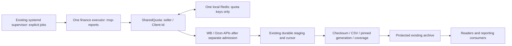

# Решение общей квоты: один финансовый исполнитель, один quota Redis

**Статус: ПРЕДЛОЖЕНО, требуется утверждение архитектуры. Ничего не развёрнуто.**
A/B закрыты; root C подтвердил NOT_CONFIGURED. Повторный поиск Redis в проверенных
каталогах прекращён. Новый Redis, API, токены и рабочие службы не менялись.

## 1. Кто может обращаться к WB finance и где

Здесь различаются endpoint capability, установленная конфигурация и доказанный
текущий трафик. Трафик WB не измерялся, provider API не вызывался. Полный список
внешних клиентов нельзя восстановить по одному VPS: для него нужны сведения
владельца/администраторов интеграций или текущего кабинета WB. Отсутствующий процесс
на VM не доказывает, что удалённый клиент остановлен.

| Программа/контур | Где | Возможность и текущий статус | Контроль квоты |
|---|---|---|---|
| Новый standalone_wb, installed PR104 | VM-817589, root-owned release, User=msp-reports995/gid985 | Код list/detail есть; unit loaded/inactive/dead, api blocked; A/B/storage PASS. Не подтверждён ни один текущий отправляемый им запрос | SharedQuota → GlobalRateController; Redis не настроен; gate off; fail-closed |
| Старый Marketplaces MCP: direct/manual finance calls | Старый REMOTE по закреплённой ARCHITECTURE; нынешнее выполнение UNKNOWN | core/client.py поддерживает authenticated finance methods; исходник есть, действующий процесс/доступ не подтверждены | stable seller hash + method/scope rules → Redis Lua; runtime endpoint/DB/ACL сейчас UNKNOWN |
| Старый WB archive queue / weekly finance archiver | Тот же документированный старый REMOTE; нынешний запуск UNKNOWN | archive_queue.py и wb_finance_archive.py вызывают list/detail через MarketplaceClient; это два entry point одного известного контура, не доказательство двух активных процессов | Общий controller Marketplaces MCP; source описывает старый local Redis. Нельзя считать связанным с новым VPS |
| Hermes daily financial picture | VM-817589, existing daily report code | Источник source_rows — Google Sheets, не finance endpoint WB; код не свидетельствует о потреблении финансовой квоты | Не включаем в finance limiter и не останавливаем |
| QRsite/сигналы/цены/остатки/1С | Локальные wrappers + внешний QRsite, отдельные сервисы | Проверенный каталог содержит stocks/orders/prices, не подтверждает endpoint list/detail финансовых отчётов. Внутренние задания внешнего QRsite не инспектировались | Finance admission UNKNOWN, не выдумывается; отсутствие exposed finance tool не доказывает отсутствие backend jobs |
| Другие облачные сервисы, учётные системы, Apps Script/ручные скрипты | Не установлен список/hosts | Возможны при наличии finance-capable токена/доступа, но конкретные программы не найдены и не именуются как установленные | UNKNOWN; нельзя заранее считать участниками Redis |

Счётчики активных finance clients НЕ объявляются: нет доказанной полноты списка.
Установленный код и действующий токен тоже не доказывают, что программа сейчас
посылает запросы. Сообщение о root C принято как результат, не повод ещё раз
искать backend в тех же каталогах.

## 2. Источники и границы самостоятельной проверки

- Canonical source marketplaces-mcp-ru0510a409ab589c639930fbca35afb3e68d874f81:
  ARCHITECTURE.md, core/client.py, core/archive_queue.py,
  core/wb_finance_archive.py, core/rate_limit.py. Это source evidence, не remote
  runtime inventory. Старый REMOTE не опрашивался и его подключение не искалось.
- Installed c1fee070e9efa0c925a78f266fdf03cb12a173cf: providers.py,
  quota.py, shared_rate_limit.py, backfill_plan.py; systemd unit metadata и
  фактический bootstrap-result.json. Loaded/inactive/dead сам по себе не
  объясняет все возможные manual invocations — обобщение ограничено.
- Bounded endpoint search *.py в standard stack apps, Hermes plugins и
  current MSP tools не выявил другого явного finance endpoint sender.
  Скрипты из review/scratch существуют, но их наличие не равно production launch.
- Процессный snapshot использовал executable/script filenames без argv values
  и environment; скрытые/удалённые процессы этим не исключены. Generic Python,
  Node, Codex, Devexec не объявлялись WB client на основании имени процесса.
- daily.py source_rows читает Sheets. QRsite capability inventory —15.10.2026,
  source limitation, не свежий audit удалённого backend. Для сопоставления
  использован навык qrsite; внешние вызовы не выполнялись.
- Свежую официальную WB документацию получить не удалось (HTTP498). Численные
  настройки ниже — принятый код проекта, не новая декларация текущего контракта
  WB. Непервичные mirrors не использовались для изменения лимитов/endpoint.

## 3. Что уже реализовано в контроле квот

У нового клиента stable owner = SHA256('wb:seller:'+sid из WB token), не имя
кабинета/хеш токена. Новый токен одного продавца не даёт независимого limiter.
Ключи finance построены из owner+host+scope finance+rate contract, preserved
namespace marketplace-rate:v1. В коде принят finance1req/min + safety65s;
page wait66s. Сохраняем без ослабления/включения gates сейчас.

Старый MarketplaceClient._quota_key использует ту же seller-derived основу;
call_spec вызывает общий try_acquire до HTTP и defer после429. Но runtime
Redis endpoint/DB/key bytes и дополнительные safety rules всех старых entry
points НЕ подтверждены. Даже одинаковый URL не доказывает одинаковую DB,
owner derivation или группу. Старый writer может не потреблять новый safety
bucket: совместимость не объявляется по одному сходству source.

Контроллер координирует только участвующих клиентов. Ни новый Redis, ни общий
IP, ни новые credentials, ни flag VERIFIED не влияют на запросы сторонней
программы, которая его обходит. Локальный flock также не cross-host protection.

## 4. Выбранная целевая архитектура

**Один владелец финансового HTTP на VM-817589; один новый локальный Redis только
для квот, после утверждения. Не общий API gateway и не новая очередь.**

Новый Redis предлагается потому, что existing approved backend не найден после
завершённого C discovery, а старый documented loopback не доступен новому VPS.
Это **предложение**, не выполненная установка и не разрешение создания.

### Конкретные свойства

- Standalone Redis на ТОМ ЖЕ VPS, отдельный OS account, TCP loopback и
  согласованный local port; порт не публикуется наружу. Точный endpoint/DB
  появляется в deployment manifest только после approval/provisioning,
  не подставляется как «найденный» из примера.
- Redis содержит только существующие quota/cooldown keys, не отчёты, не токены,
  не job queue. Единственные request cursor/budget остаются в текущем archive
  state. Никакой новой Redis-очереди или второго HTTP worker.
- Persistence AOF, no eviction quota keys, private config/data/backup;
  appendfsync policy и проверка fsync errors входят в отдельный provisioning
  review (предпочтение для малой квоты — always, не обещание performance).
- Redis ACL runtime-пользователь только namespace WB/Ozon quotas и команды
  существующих Lua/controller: ограниченные GET/SET/TIME/EVAL и connection
  handshake. Без FLUSH/CONFIG/ACL/полного keyspace. Отдельный READ_ONLY principal
  для C, если поддержан выбранной версией; не расширять текущие службы/ACL.
- MARKETPLACE_REQUIRE_REDIS=1 исключает незаметный SQLite fallback. Локальный
  запуск Redis делает backend один, но это не доказательство участия внешних
  клиентов. Shared gate остаётся off до cutover evidence и runtime validation.
- Недоступность/потеря persisted quota state/подозрение rollback → HOLD, не
  восстановление ключей «нулём» и не автоматический HTTP. Replay filesystem
  cursor не должен откатывать request budget. Redis restart/loss acceptance
  проверяется без provider HTTP с отдельно разрешёнными synthetic writes.
- Сохраняем текущего msp-reports, code release и pilot credential. Не меняем
  Hermes/Telegram/1C/сигналы. Сетевой запрет pilot unit снимается ТОЛЬКО при E,
  а не ради установки Redis; C выполняется отдельной диагностикой.

## 5. Что делать с остальными клиентами

Рекомендуемый путь — **передать финансовую загрузку одному исполнителю**, а не
пытаться незаметно подключить недоступные старые программы к новому Redis.

1. Все задания загрузки на новом VPS проходят через существующие sender и
   SharedQuota с одним local backend/DB; параллельные процессы потребляют те же
   seller keys. Alias кабинета не отдельная квота; sid/Client-Id сверяются
   приватно до расширения на шесть кабинетов.
2. Известные старые/внешние программы больше НЕ отправляют finance HTTP, а
   получают подтверждённые выгрузки из архива через согласованный read path.
   Не создаём сейчас новый read API/daemon. Формат доставки согласовывается
   с каждым потребителем; отсутствие такого интерфейса не оправдывает direct API.
3. Финансовые jobs доступных клиентов останавливаются/переключаются их админом
   только после отдельного owner cutover approval. Non-finance интеграции
   (цены/остатки/заказы) не отключаются автоматически.
4. Если прежний клиент/его секреты недоступны, требуется подтверждённое прекращение
   его finance-capable доступа через текущий кабинет/поддержку WB. Не ищем старый
   сервер. Новый token сам старые не отзывает. Права конкретного токена могут
   затрагивать другие нужные методы: перед отзывом составляется impact list и
   отдельно согласуются замены. Избирательное изменение scope старого токена
   не предполагается как гарантированная возможность WB.
5. Если бизнес РЕШИТ сохранить дополнительный прямой finance client, этот client
   обязан быть явно подключён к тому же Redis по approved private authenticated
   TLS/VPN route, тем же DB/namespace/owner/rules и safety/cooldown. Понадобятся
   изменение его config/адаптера и cross-client acceptance BEFORE HTTP.
   Loopback нового VPS недоступен с другого хоста. Открывать6379 в интернет,
   давать чужому сервису Redis admin или создавать вторую namespace запрещено.
   Это усложнение — отдельная ветка решения, не часть рекомендуемого cutover.
6. У стороннего сервиса без поддержки shared limiter остаются только получение
   архива либо отдельно утверждённый полный stop его finance-доступа. «Паузы
   по расписанию» и «он редко запускается» не дают взаимного исключения.

**Сейчас никакие клиенты не переключены/не отключены и токены не отозваны.**
Если нельзя подтвердить учёт/прекращение неизвестных клиентов, shared guarantee
отсутствует и pilot остаётся NO-GO даже при установленном новом Redis.

## 6. Один практический план до автономных отчётов

| Шаг | Конкретное действие/результат | Допуск |
|---|---|---|
|1. Решение архитектуры | Утвердить single-finance-executor + один local quota Redis, без нового scheduler/queue. A/B не повторять | Новое approval именно Redis architecture/provisioning |
|2. Finance-client cutover list | Заполнить CUTOVER_REGISTER.csv по3 WB alias: кто имеет finance access, host, admin, что выключается или адаптируется, evidence/effective time. Не собирать token values | Metadata/read; реальные остановки/отзывы только отдельный D |
|3. Provision quota backend | Установить один Redis, private auth/DB/persistence, protected Redis-only config; проверить текущим C probe | Только после шага1; нет provider HTTP |
|4. Runtime quota acceptance | Approved isolated synthetic owner tests:2 процесса, один owner/разные token aliases, разные seller, cooldown, unavailable/restart/no-reset. Никаких live seller ключей и provider. Приёмка async/Lua, а не только sync PING | Отдельное разрешение synthetic Redis writes; текущий C только READ_ONLY |
|5. Завершить cutover | Подтверждённые stops/отзывы/адаптация всех finance clients, время вступления/переходный интервал, полный scope доступа. Не делать вывод по тишине/нет429 | Отдельный D; до подтверждения gates off |
|6. Один WB pilot | wb_laser_master/main883801632, max3 durable send entries, unknown size. Terminal204→page hashes→CSV→generation→coverage→repeat without API. Иначе PAUSED_BUDGET, не ложный COMPLETE | Отдельный E после3–5 |
|7. WB2026 backfill | Existing discovery+backfill planner, main+buyout, все3 WB cabinets с подтверждённым seller mapping; явные report-unit batches с budgets и resources/space guard | Расширение E с scope/годом/лимитами, не unlimited flag |
|8. Автоматизация и Ozon | Existing systemd timer/supervisor для тех же bounded jobs, persisted not-before/cursor, backup/alerts. Ozon по3 cabinets, Client-Id global/specific cooldown, method schemas+bounded adapter acceptance отдельно | Не активируется этим документом |

Шаг2 идёт параллельно3–4, не задерживает offline подготовку WB. Это не предложение
ещё раз искать Redis. До нового provisioning нужно решение1, до HTTP обязательно5.
Ни A/B, ни C, ни новый Redis не включают E автоматически.

### Что означает результат2026

В коде определены wb_laser_master, wb_novokshenov, wb_dmitrieva и три соответствующих
ozon_ кабинета. Это aliases, не доказательство разных seller IDs/Client-Ids.
Сначала один реальный WB отчёт, затем gaps inventory по отчётам/типам/годовым
границам, после — дозагрузка новых/исправленных опубликованных отчётов по расписанию.
Не объявлять весь2026 готовым до публикации всех периодов и исправлений.

Ozon FINAL realization не равен всем финансовым видам; FBO/FBS orders и accruals
не подменяют отсутствующий официальный финансовый отчёт. Existing modules
сохраняются, но standalone dispatcher и свежие method contracts ещё требуют
приёмки. Ozon не задерживает WB; объединять платформы в один global limiter нельзя.
Backup настоящего архива, restore без отката бюджета, capacity/RAM annual
publisher проверяются до массового backfill; synthetic storage smoke не заменяет
этих проверок. Не назначаем срок полной выгрузки без реального размера/числа страниц.

## 7. Что требуется от владельца сейчас

Одно архитектурное решение: **согласовать новый local quota Redis и передачу
финансового API одному исполнителю на VM-817589**. Это НЕ просьба повторно
разрешить A/B/C и не разрешение текущей установкой исполнять D/E.

После согласования — точный root provisioning пакет только Redis/config,
использующий уже установленный загрузчик. Не новый installer всего проекта.
Параллельно владелец/ответственный за кабинеты даёт metadata finance integrations
или redacted подтверждения из текущего WB кабинета/поддержки. Пароли/токены в чат
не нужны. Без этих внешних сведений утверждение «все клиенты учтены» было бы выдумкой.
